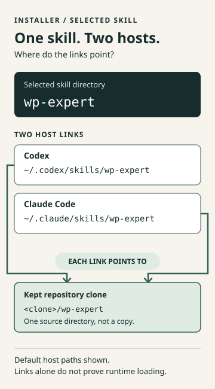

# Where does a selected skill link?

For example, run `bash scripts/install-global-skill-links.sh wp-expert` from a
clone you intend to keep. With valid input and no path conflicts, the installer
creates or confirms a symbolic link for `wp-expert` in **both** host skill
directories. Each link points back to the same `wp-expert` directory in that
clone; the skill is not copied. The installer also links the clone's `shared`
and `templates` directories in both hosts.

The default host roots are `~/.codex/skills` and `~/.claude/skills`;
`CODEX_HOME` and `CLAUDE_HOME` can change them. The script validates the skill
and target paths before linking. Existing non-symlink paths are preserved, and
incorrect links are skipped unless `--force` is explicitly supplied. Other
optional design-default operations are separate from this example.

A filesystem link does not prove that either host discovers or loads the skill
at runtime. See the [installer source](../../scripts/install-global-skill-links.sh)
for the complete behavior and options.
